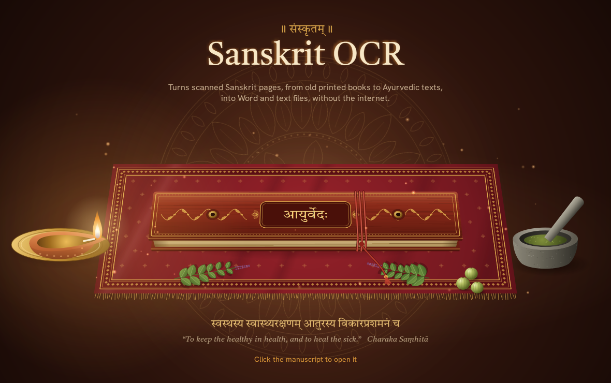
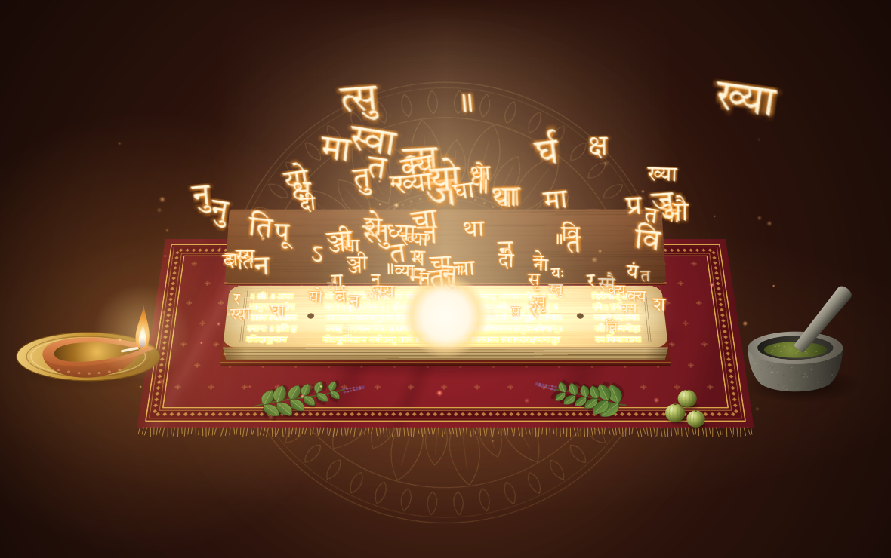
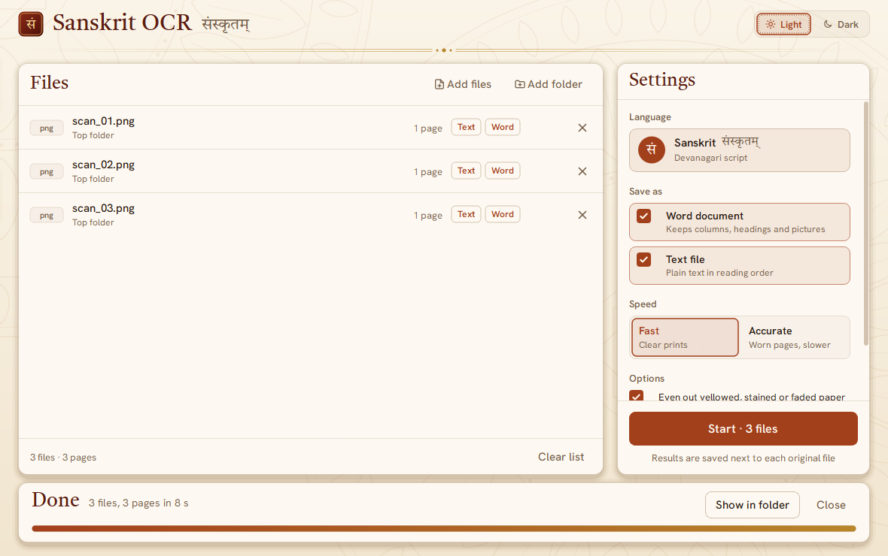
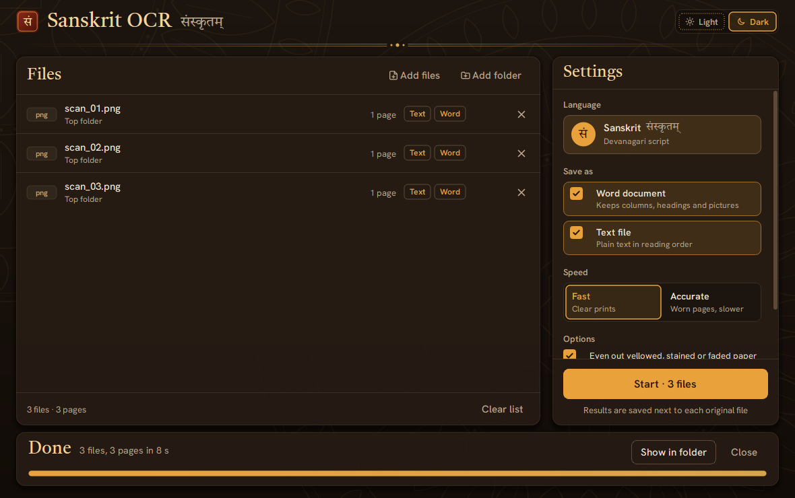

# Sanskrit OCR · संस्कृतम्

An offline Windows app that turns scanned Sanskrit pages, from old printed books to
Ayurvedic texts, into Word and text files. It needs no internet connection and no graphics card.



## What it does

- Reads Sanskrit in Devanagari from scanned images (PNG, JPG, TIFF, BMP, WEBP, GIF, JP2) and PDFs.
- Saves a Word document that keeps columns, headings and pictures, and/or a plain text file, next to each original.
- Works through whole folders, including the folders inside them, using all processor cores.
- Evens out yellowed, stained or faded paper before reading. This option is on by default, because old documents are what it is for.
- Turns sideways or upside-down pages the right way up, and uses the text already inside a PDF when that text is correct.
- Everything stays on your computer.

## Screenshots

Click the manuscript: its cover swings open, its letters lift off the leaf as light, and the light opens into the app.



The app is light by default. Use the switch in the top-right corner for dark mode.

| Light | Dark |
|---|---|
|  |  |

## Download and run

1. Download `Sanskrit-OCR-<version>-win64.zip` from [Releases](https://github.com/Chaitu191999/sanskrit-ocr/releases/latest).
2. Unzip it anywhere, such as the desktop or a USB drive. No installation is needed.
3. Open `Sanskrit OCR.exe`.

It runs on Windows 10 or 11, 64-bit. A 4-core laptop with 8 GB of memory is plenty. The unzipped folder is about 350 MB.

Windows may warn that the app is from an unknown publisher, because the exe is not code-signed. Choose **More info → Run anyway**.

## How to use

1. Drop scanned pages, PDFs or folders onto the window, or use **Choose files** / **Choose a folder**.
2. Choose **Word document** and/or **Text file**. Choose **Fast** for clear prints, or **Accurate** for worn pages (3–4× slower).
3. Press **Start**. Each result is saved next to its original file as `<name>_OCR.docx` / `<name>_OCR.txt`. Click **Word** or **Text** on a finished file to open it.

The app remembers your settings in `%APPDATA%\Sanskrit OCR\settings.json`. If something goes wrong, details are written to `%LOCALAPPDATA%\Sanskrit OCR\sanskrit.log`.

## How well it reads

These tests used printed Sanskrit text. The "aged" pages were the same text made to look old: yellowed paper, faded ink, a stain and uneven light.

| Test | Characters read wrong |
|---|---|
| Clean pages, Tesseract's Sanskrit model + English (the usual setup) | 27.7% |
| Clean pages, this app (Devanagari script model) | 22.5% |
| Aged pages, paper clean-up off | 73% |
| Aged pages, paper clean-up on | 22.7% |

The app reads with Tesseract's Devanagari script model alone. On 312 printed lines it beat Tesseract's dedicated Sanskrit model: the median line had 8.7% of its characters wrong, against 11.3%.

## Limits

- It reads **printed** text, including old letterpress and lithographed books. Handwritten or incised palm-leaf manuscripts are not read well.
- Vedic accent marks and rare ligatures may be missed or misread.
- Tables are rebuilt from how the text lines up, so ruled tables can come out as paragraphs.
- Word uses Nirmala UI for the Devanagari text, so line breaks can differ from the original page.

## Build from source

You need Python 3.12 on Windows.

```bat
python -m venv .venv
.venv\Scripts\python.exe -m pip install -r requirements.txt
.venv\Scripts\python.exe build.py --fetch-models
```

`--fetch-models` downloads the two models the app uses (`script/Devanagari` and `osd`, Fast and Accurate) into `build_assets\tessdata\`.

Next, copy `tesseract.exe` and its DLLs from a Tesseract 5.x Windows build into `build_assets\tesseract\`. The [UB Mannheim installer](https://github.com/UB-Mannheim/tesseract/wiki) or conda-forge's `tesseract` package both work.

To run the app without building it:

```bat
.venv\Scripts\python.exe run_sanskrit.py
```

To build the self-contained folder:

```bat
.venv\Scripts\python.exe build.py
```

This creates `dist\Sanskrit OCR\Sanskrit OCR.exe`.

## How it is made

The interface is Qt Widgets (PySide6), drawn by Qt's own software renderer, so it needs no browser engine and no GPU. The welcome screen is painted with QPainter when the app starts; no picture files are bundled.

The manuscript on the welcome screen is a small 3D model, and its faces are drawn in perspective so the cover can swing open on its hinge. Its leaf carries real text: the opening of the Charaka Saṃhitā, the first verse of the Aṣṭāṅga Hṛdaya, and Charaka's *svasthasya svāsthyarakṣaṇam*.

```
sanskritocr/          the app
  main.py             start-up, settings, logging; fixes the language and model
  ui/theme.py         light and dark palettes, fonts, Qt style sheet
  ui/art.py           manuscript, cloth, lamp, mortar, tulsi, amla, mandala, glowing letters
  ui/splash.py        welcome screen and the opening animation
  ui/widgets.py       cards, drop zone, file list, toggles, progress bar
  ui/window.py        main window
  assets/             fonts (Tiro Devanagari Sanskrit, Hanken Grotesk), icons
ocrapp/               OCR engine, shared with the multilingual Akshar OCR
  engine.py           Tesseract calls, orientation, figures, PDF text layers
  paper.py            aged-paper clean-up
  pipeline.py         files, parallel pages, writing outputs
  layout.py, docx_writer.py   reading order and Word output
build.py              builds the Windows folder with PyInstaller
```

## License

The code is licensed under the [GNU AGPL v3](LICENSE). The app bundles Tesseract, Qt, PyMuPDF and two open fonts, each under its own license. See [THIRD_PARTY_NOTICES.md](THIRD_PARTY_NOTICES.md).
